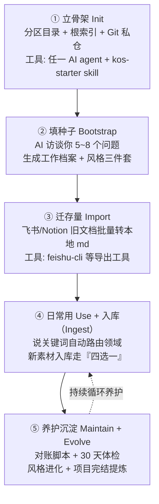
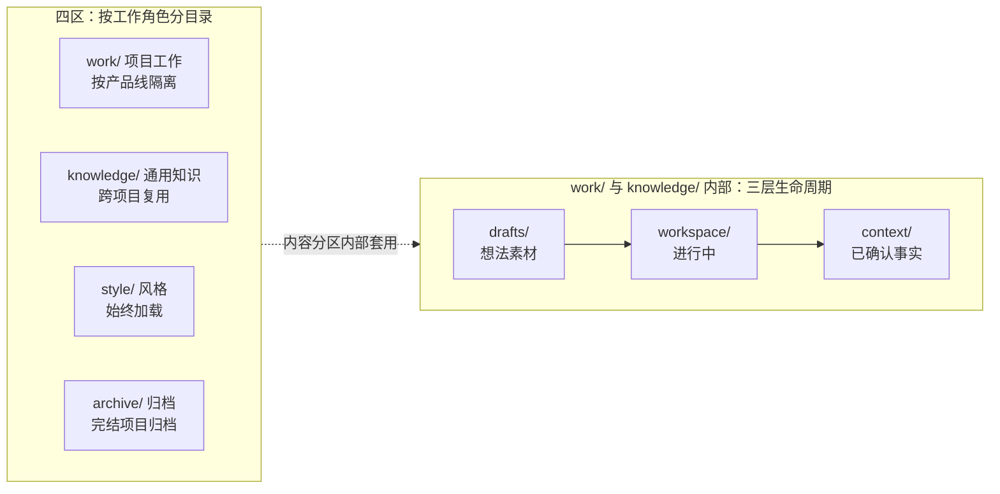

# 个人 AI 工作流搭建方案：从零到 AI 分身

> 一句话：把 AI 每次都要重复听的「背景介绍」写成本地文件，让任何 AI 工具一开门就自己读。
> 本文来自一套已实战数月的个人知识库（KOS，Knowledge Operating System），裁剪为**公司工作场景版**：面向没用过 AI agent 的同事，照做 30 分钟可起步（最小版见第五章；完整结构约半天起步，取决于存量文档多少）。全程工具中立，每个环节都给替代选项。
> **配套 skill**：kos-starter（起步引导+日常入库托管，公司场景版）——装进你的 AI 工具后说「搭建知识库」，AI 会带你搭出最小版并托管日常使用；skill 与本方案口径一致（四区结构、四台阶、信息安全红线）。安装说明见该 skill 的 README.md。

---

## 一、原理：为什么这样搭

先讲清 5 件事，后面所有设计都从这里推出来。

### 1. 输入 = 命令 + 上下文，输入决定输出

AI 的输出质量不取决于你话说得多漂亮，而取决于它回答前读到了什么。公式：**输入 = 命令（Prompt）+ 上下文（Context）**。上下文就是 AI 干活前读到的背景资料：你是谁、产品是什么、规矩有哪些。它是**可复用资产**：写一遍，之后无数次对话直接复用。相反，每次聊天都重新粘贴背景，等于每天重造轮子。

### 2. 三层生命周期：知识单向流动

每个目录内分三层，代表知识的成熟度：

| 层 | 装什么 | 例子 |
|---|---|---|
| `drafts/` | 想法、素材、没验证的东西 | 一篇收藏的文章、一个灵感 |
| `workspace/` | 进行中的工作 | 写到一半的 PRD、正在跟的项目 |
| `context/` | 已确认的事实 | 产品架构、方法论、竞品档案 |

流动方向固定：`drafts/ → workspace/ → context/`，只升不降。配套一个「温度」概念：`context/` 是冷内容（很少变、处处被引用），**最先写、ROI 最高**；`workspace/` 是温的；`drafts/` 是热的（天天变），最后补。

### 3. 四大分区：按工作角色分目录

```
work/       项目工作，按产品线隔离（项目完结整体归档）
knowledge/  通用知识：方法论、设计规范、竞品档案、行业认知（跨项目复用）
style/      风格层：你怎么思考、怎么表达、认为什么是好（AI 分身的风格种子，每次对话始终加载）
archive/    归档：完结项目的整体归档区，方法论精华提炼入 knowledge/
```

`style/` 是 AI 分身的核心：把你的决策习惯、表达偏好写成三个文件（thinking / communication / taste），AI 就能按你的风格处理工作、表达产出。

### 4. 敏感度三级：用 .gitignore 落地

| 级别 | 含义 | 落地方式 |
|---|---|---|
| 🟢 | 可公开（如公开行业文章收藏、已对外发布的内容） | 正常进 Git，可推远程 |
| 🟡 | 公司工作内容（默认级） | 照常进 Git，但远程仓库必须是**私有**，仅限工作需要的人访问，永不对外公开 |
| 🔴 | 红线机密 | 不入 Git（`.gitignore` 排除）+ 不入索引（对 AI 不可见）；最稳妥是物理隔离——存在知识库之外 |

Git 是版本管理工具（记录每次修改、可回滚、可同步云端）。做法：远程仓库建私有的，🟢/🟡 内容照常提交推送，换电脑不丢；🔴 用 `.gitignore` 写规则排除（如 `**/_private/`），被排除的目录 Git 永远不碰。注意两点：① `.gitignore` 只管 Git，管不住 AI 读文件系统——🔴 内容除了排除出 Git，还不能登记进任何索引（未索引对 AI 不可见），最敏感的直接存库外物理隔离；② 🟡 是要进私有远程的，别误加进 `.gitignore`。

**信息安全红线（公司场景必读）**：库文件本身不出你的电脑，但 AI 读库意味着内容会随会话发送给它背后的模型服务商——**会话本身不保密**。凡属公司红线的内容（核心经营数据、薪酬信息、未公开的合作与商务条款等）一律不入库、不进会话，遵守公司信息安全规定；拿不准某类内容能不能用 AI 处理，先确认安全口径再动手。对抗审查、反向同步云端等外发动作，同样受安全口径约束。

### 5. 索引即导航：AGENTS.md

每个目录放一份 `AGENTS.md`（给 AI 看的目录说明书：这里有什么、规矩是什么）。**硬规则：AI 读任何文件前先查索引，未索引的文件对 AI 不可见。** 好处是 AI 不会乱翻文件、不会被垃圾内容污染；代价是新增文件必须同步登记索引，这件事后面用脚本自动化。

索引有两种合法形态：**逐文件白名单**（只列出者可见，适合持续维护的核心目录）和**目录级索引**（目录行声明整目录可见，适合竞品素材、行业报告这类成品参考集——AI 可对整目录自由检索，免去逐文件登记的维护成本）。库小的时候全用白名单；某些目录文件多、更新频、当参考集用时，再给它开目录级索引。

### 6. 个人库与团队知识的边界

这套方案搭的是**个人工作上下文库**——装的是「让 AI 更懂你的工作」的背景，不是团队知识库的替代品。边界：个人库管个人工作上下文（项目档案、方法论、风格）；需要团队共识的结论（评审拍板的方案、对外口径、沉淀文档）通过反同步机制回流飞书——飞书仍是公司正式文档源，个人库是 AI 工作的输入层，两者不打架。

---

## 二、总流程图

搭建加养护共 5 个节点，前 3 步一次性做完（约半天到几天，取决于存量文档多少），后 2 步是日常循环。**本章描述的是目标态全貌；新手实操按第五章路线分步走**——第 0 天只需最小版，不必一步到位：



配套的「分区 × 三层」结构图（work/、knowledge/ 两个内容分区内部套用三层生命周期；style/ 为扁平风格文件，archive/ 为终态归档，不套三层）：



---

## 三、节点展开

### ① 立骨架（Init）

**干什么**：建分区目录、写根 `AGENTS.md`（分区路由表 + 触发关键词 + 索引规则）、`git init` + 私有远程仓库、写 `.gitignore` 落实敏感度红线。

**怎么做**：
0. **前置确认（公司场景先做这步）**：先确认公司对外部 AI 工具与外部代码仓库的许可口径——有公司内网 GitLab 或公司指定仓库的，**优先用公司载体**，个人 GitHub 私仓仅作公司无管控时的替代选项；同时过一遍本机环境（装机权限、网络可达性、工具是否收费），有限制就用替代选项
1. 装一个 AI 编码工具（下方工具表任选其一）：**OpenCode**（开源免费，GitHub 搜 opencode，按说明安装）、**Claude Code**（Anthropic 出品）、**Cursor**（官网下载，图形界面最好上手）。共同点：能对话、能读写本地文件。装好后把工作目录打开到你的知识库文件夹（图形工具用「打开文件夹」，命令行工具用 cd 命令进入）
2. 装了 kos-starter skill 的（skill = 给 AI 装的「能力包」，本质是一个带说明书的文件夹，放进工具的 skills 目录，AI 会自动读取；GitHub 搜 OYAlivn/skills 可获取），直接说「搭建知识库」，AI 会带你 30 分钟搭出最小版——公司场景从最小版起步即可，完整分区结构等库长大后再升级（见第五章进阶路线）；skill 已与本方案口径对齐，照手册走即可
3. 没装 skill 的，把本文「一、原理」的分区结构 + 索引规则粘贴给 AI，让它照建
4. 根索引里写清：分区路由表（什么关键词加载什么目录）、敏感度分级规则、「style/ 始终加载」
5. `git init` + 建**私有**仓库 + 写 `.gitignore`（`**/_private/`、你的 🔴 目录等——注意 🟡 是要进私有远程的，不要写进 `.gitignore`）
6. 每个 AI 红线动作（删除、推送、改配置）要求先确认，写进根索引

**工具选择表**：

| 工具 | 类型 | 干什么 | 替代选项 |
|---|---|---|---|
| OpenCode / Claude Code / Cursor / Codex | AI agent | 对话式建目录、写索引 | 任意能读写本地文件的 AI 工具 |
| kos-starter（开源，起步引导） | skill | 说「搭建知识库」带你搭出最小版 | 无 skill，手动粘规则给 AI |
| context-engineer（开源，进阶深耕） | skill | 库长大后做单项目级深度 context 管理 | 非必需，配合 kos-starter 用 |
| Git + 私有远程（优先公司内网 GitLab 等公司载体；无公司载体时用 GitHub/Gitee 私仓） | 版本管理 | 存档、换机不丢 | 纯本地（无异地备份，机器故障即丢失） |
| .gitignore | 配置文件 | 落实敏感度红线 | 无 |

### ② 填种子（Bootstrap）

**干什么**：冷内容优先。AI 用访谈方式（5~8 个问题）从你脑子里提取事实，生成工作档案（岗位与产品线背景、项目历程、常用方法论）和风格三件套（thinking / communication / taste）。原则是「你的大脑是初始事实的唯一来源」：AI 只做结构化整理，不编造通用内容。

**怎么做**：
1. 说「搭建知识库」，AI 开始提问：你是谁、负责什么、过去几年干过什么项目、哪些话反复对不同 AI 解释过
2. 喂给 AI 你的既有写作样本（周报、邮件、评审意见），让它提炼表达习惯和决策偏好，生成风格三件套初稿
3. 风格文件 AI **提议后须你确认**才写入，绝不自动生成风格画像
4. 生成后通读一遍，删掉 AI 脑补的内容，只留你认可的
5. 每个新文件登记进对应目录的索引

**工具选择表**：

| 工具 | 类型 | 干什么 | 替代选项 |
|---|---|---|---|
| AI agent（Bootstrap 流程） | skill 内置访谈 | 提问 + 生成种子文档 | 让 AI 问你三个问题后代填（你怎么做决定 / 你说话什么风格 / 你反感什么） |
| 写作样本 / 周报 / 邮件 | 原始素材 | AI 从中提炼风格 | 口头描述你的习惯 |

### ③ 迁存量（Import）

**干什么**：把散落在飞书/Notion/语雀/浏览器收藏夹里的旧文档，批量导出为本地 Markdown。**原则：本地 md 是 AI 工作的输入真相源；飞书仍是公司正式文档源，两者分工不打架。** 图片必须相对路径化（`assets/文档名/图1.png`），否则换环境就裂图。

**怎么做**：
1. 飞书用户装 feishu-cli（开源命令行工具，GitHub 搜 riba2534/feishu-cli），完成 OAuth 用户授权（扫码，一次即可）
2. 说「从飞书导入 xxx 文件夹」，AI 批量导出为 md 并下载图片
3. 跑图片路径修复脚本：把飞书专有的图片标记替换为标准 `` 相对路径，并按章节语义重命名图片
4. 图片只存本地不进 Git（`.gitignore` 排除 `**/assets/`）——防止仓库被图片撑爆；换机时通过公司认可的方式单独同步图片目录
5. Notion/语雀用平台自带「导出为 Markdown」，再让 AI 按分区分类落位
6. 每批迁移完，AI 更新索引 + 记录流水账（哪天、迁了什么、放到哪）
7. 不装任何工具也行：直接把网页内容复制粘贴给 AI，说「存到知识库」

**工具选择表**：

| 工具 | 类型 | 干什么 | 替代选项 |
|---|---|---|---|
| feishu-cli | CLI | 飞书双向同步，导出含图片 | 手动复制粘贴；其他导出工具 |
| Notion/语雀自带导出 | 平台功能 | 批量导出 md | AI 代跑导出脚本 |
| 图片路径修复脚本 | 脚本 | 绝对路径改相对 + 语义命名 | 让 AI 现场写一个 |

### ④ 日常用（Use + Ingest）

**干什么**：这是日常主循环，两个动作。**用**：开新会话，AI 自动读根索引，按你话里的关键词加载对应领域，带着完整上下文干活。**存**：新内容入库走 Ingest 流程，AI 先分诊再落笔。

**怎么做**：
1. 会话开场直接说任务：「xx 产品线的需求分析」「写一份竞品分析」，AI 按关键词路由领域（项目域 + 风格层）
2. 给新素材时说「记录这个」，AI 先报「四选一」：**新货**（库里没有，走完整入库）/ **补货**（有同类，更新旧文件）/ **有矛盾**（与既有结论冲突，双方都保留并就地标注待裁决）/ **没营养**（无实质价值，只存原始件 + 记流水账）。最后一个是关键设计：给 AI 合法出口，不强行写入污染知识库
3. 拿不准的一律进 `drafts/`，宁可错存不可错删；升级到正式目录只在你明确要求时发生
4. 重要产出（方案、PRD）开**双 AI 对抗审查**：让两个立场相反的 AI 各审一遍，一个验证目标是否达成，一个专职挑刺，两边结论交叉看
5. 需要对外展示时，用 CLI 把本地 md 反向同步回飞书，人看云端、AI 看本地，两边不打架
6. 阶段性 `git commit`（记录一次改动），搞砸了随时回滚

**工具选择表**：

| 工具 | 类型 | 干什么 | 替代选项 |
|---|---|---|---|
| AI agent | 主体 | 读索引、路由领域、写作 | 所有兼容 AGENTS.md 的工具 |
| MCP 服务 | 协议扩展 | 按需加视觉理解/浏览器/文档查询能力（MCP = AI 连接外部工具的通用协议，装进 AI 工具里用） | 不装，纯文本场景零扩展也够用 |
| feishu-cli | CLI | 本地产出反向同步回飞书 | 手动上传 |
| Git | 版本管理 | 每次修改可回滚 | 无 |
| Obsidian（可选） | 浏览层 | 人类图形化浏览双链笔记 | VSCode 的 md 预览 |

### ⑤ 养护与沉淀（Maintain + Evolve）

**干什么**：知识库会烂：文件加了没登记、结论过时了、结构漂移。养护靠三层机制：脚本对账、定期体检、知识沉淀。

**怎么做**：
1. **对账脚本**：写一个只读检查脚本（实战版叫 Check-KOSIndex），核对「索引列的文件是否都存在、存在的文件是否都被索引、断链、孤儿引用」，输出报告不自动改。让 AI 现场生成一个即可
2. **事件驱动对账**：每次批量操作（导入、迁移、清理）收尾时自动跑一遍脚本，发现项当场修，不攒到月底
3. **30 天体检**：结构层（跑对账脚本）+ 内容层（清单项：结论矛盾、孤儿文档、概念缺页、内容时效、敏感度误放等——让 AI 按此生成体检清单），每项要求写「实际结果」防止报喜不报忧
4. **纠偏即规范**：你纠正过 AI 一次的说法（比如某类文件必须放哪），当场写成规范文件进索引，AI 下次不再犯。原则：重复性知识零容忍，第二次遇到就固化成文档或脚本
5. **AI 主动回填**：协作中产生的新理解，AI 识别后**提议**回填到对应文件（链接原文、区分「原话」和「推断」），你确认才写
6. **项目完结提炼**：产品线结束或阶段性完结时，`work/{产品线}` 整体移入 `archive/` 原样冻结（剔除 🔴 级内容），可复用的方法论（需求拆解模式、设计规范、踩坑记录）提炼汇入 `knowledge/`。这是知识库对经验资产最大的复利——每个项目结束都沉淀为可复用的知识，下个项目从上一个的肩膀起步

**工具选择表**：

| 工具 | 类型 | 干什么 | 替代选项 |
|---|---|---|---|
| 索引对账脚本 | 脚本 | 索引↔文件账实核对，只读报告 | 让 AI 手工扫描（慢且漏） |
| 体检清单 | 检查文档 | 30 天内容级体检 | AI 自由发挥（口径不稳定） |
| 第二个 AI 视角 | agent | 双 AI 对抗审查（另一工具，或同一工具里的审查代理） | 单 AI 自检清单 |

---

## 四、使用方法：日常场景速查

| 场景 | 你说什么（触发词） | AI 做什么 |
|---|---|---|
| 开新会话干工作 | 「xx 工作」或直接说任务 | 读根索引 → 关键词路由领域 → 带上下文干活 |
| 存一篇好文章 | 「记录这个」+ 粘贴内容或链接 | 先报四选一 → 落位 → 更新索引 → 记流水账 |
| 同步云端文档 | 「同步飞书 xxx」 | CLI 导出含图片 → 修图片路径 → 入库登记 |
| 知识库体检 | 「体检」 | 先跑对账脚本，再做内容级检查，出报告 |
| 换电脑迁移 | 「迁移知识库」 | 按 AI 生成的迁移清单打包（仓库+配置，凭证类敏感项单独保管），新机还原后逐项验证 |
| 写周报/阶段复盘 | 「写周报」 | 加载项目域 + 风格层，按你的结构产出 |
| 项目完结/阶段复盘 | 「项目完结提炼」 | 项目域整体归档冻结（剔除红线内容），方法论提炼汇入通用知识 |

---

## 五、最小可行版：30 分钟起步

别被分区三层吓住。**内容比结构重要，先有鸡再修鸡窝。** 最小版只要三样东西：

1. **一个文件夹**：放你的 md 文件
2. **一份 AGENTS.md**：告诉 AI 这个库有什么、规矩是什么，十几行就够
3. **一个 AI 编码工具**：能读写本地文件即可

另外三条安全规矩**从第一天就立**，别等两周后升级才想起（红线内容一旦入库，事后删不如事前防）：

1. 红线内容（公司机密、核心经营数据、薪酬类）不入库、不进 AI 会话
2. 拿不准某类内容能不能用 AI 处理，先确认安全口径再动手
3. 库推远程前，确认用的是公司认可的存储载体

根索引极简模板（可直接抄）：

```markdown
# 我的工作知识库
## 这里有什么
- profile.md   我的岗位与项目背景
- methods/     我沉淀的方法论，一个文件一个领域
- notes/       收藏的文章和灵感
## 规矩
1. 回答前先读本文件，只引用上面列出的文件
2. 我让你「记录」的内容，先分诊（新货/补货/有矛盾/没营养）再落位，存入后在下面登记
3. 不确定放哪的进 notes/，不确定的事实标注「待验证」
4. 红线内容（公司机密、核心数据、薪酬类）不入库、不进对话；拿不准能不能用 AI 处理，先问我
## Recent
- 2026-10-27 profile.md：初版
```

再立三条规矩，能帮你避开「回头再看」的坑：

1. **索引不写死篇数**：只列文件名，不写「共 N 篇」。数字会过时，漂移一次全场失信；要统计让脚本算
2. **新文件只追加流水账**：索引尾部留「Recent」区，新文件追加一行，不改正文，降低维护成本
3. **给 AI「没营养」合法出口**：素材没价值就存原始件 + 记一笔，不强行入库。垃圾进了正式目录才是灾难

**进阶路线**（每一步都独立可用，随时停下）：

| 时点 | 做什么 |
|---|---|
| 第 0 天（30 分钟） | 最小版：文件夹 + 根索引 + AI 工具 |
| 用 2 周后 | 加四区目录（profile/methods/notes 按分区归位）+ 敏感度 `.gitignore` + Git 私有仓库 |
| 用 1 个月后 | 加对账脚本 + 事件驱动对账 + 30 天体检清单 |
| 用 3 个月后 | 加风格层三件套 + 双 AI 对抗审查 + 项目完结提炼机制 |

---

## 六、跨工具兼容说明

知识库底座（文件夹 + Markdown + AGENTS.md 索引）与 AI 工具是**解耦**的：换工具不换库。`AGENTS.md` 是开放标准（OpenAI 2025 年 8 月发起，同年 12 月捐赠给 Linux 基金会旗下 Agentic AI Foundation 中立托管），主流 AI 编码工具原生支持。此外，Claude 的 skills 目录格式（SKILL.md）已被多数工具兼容读取；MCP（Model Context Protocol，AI 连接外部工具的通用协议，同样由 Linux 基金会旗下基金会中立托管）也是跨工具的，视觉理解、浏览器等扩展能力不会被单一工具锁死。

| 工具 | 根索引文件 | 目录索引 | 说明 |
|---|---|---|---|
| OpenCode | AGENTS.md | AGENTS.md | 原生支持 |
| Claude Code | AGENTS.md（新版原生支持） | AGENTS.md | 旧版用 CLAUDE.md，内容一致即可 |
| Codex | AGENTS.md | AGENTS.md | 原生支持 |
| Cursor | AGENTS.md（或 .cursorrules） | AGENTS.md | 子目录规则读 AGENTS.md |
| Amp / Zed 等 | AGENTS.md | AGENTS.md | 原生支持 |

通用建议：一律生成 `AGENTS.md`，可移植性最好；个别只认自己配置文件的工具，让 AI 做一份同内容副本即可，源头仍以 AGENTS.md 为准。

---

## 附：三条灵魂原则

1. **内容比结构重要**：一个内容丰富但目录丑陋的库，胜过一个结构精美但空空如也的库。先有鸡再修鸡窝
2. **拿不准就进 drafts**：错存可以事后升级，错放进「已确认事实」会污染整个库的判断
3. **写一遍，用无数次**：每当你第二次向 AI 解释同一件事，就该停下来把它写成文件了
